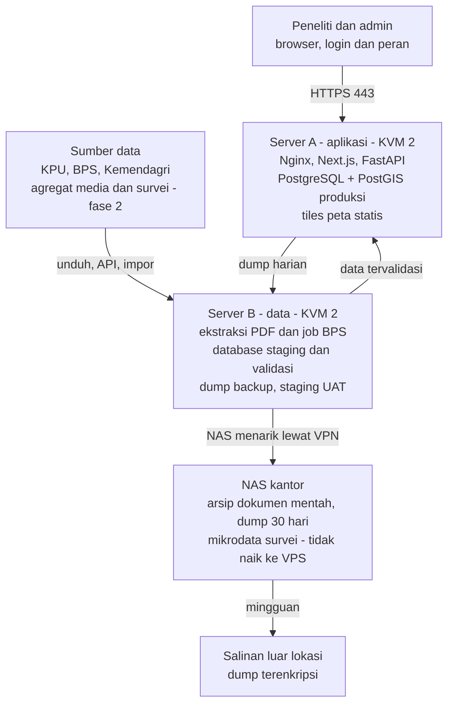

# Revisi Rancangan Realistis — Populi Electoral Dashboard (v1.1)

Tanggal: 19 November 2026 · Status: **cakupan aktif**. Bila berbeda dengan `PRD.md` atau `SDD.md` (v1.0), dokumen ini yang berlaku.

Rancangan ini memangkas pilot menjadi peta elektoral Jawa Barat 2019 dan 2024 sampai tingkat kecamatan, dijalankan di dua VPS KVM 2 dengan backup ke NAS, dan selesai dalam sekitar 20 minggu oleh tim 2–3 orang. Media dan survei masuk di fase 2 sebagai data agregat, bukan sebagai scraper baru di dalam sistem ini.

## 1. Perubahan dari v1.0

| Aspek | v1.0 | v1.1 (revisi) | Alasan |
| --- | --- | --- | --- |
| Kedalaman peta | Sampai desa/kelurahan | Sampai kecamatan | Data resmi tingkat desa tidak tersedia seragam; Sirekap dan Situng bukan hasil resmi |
| Jenis pemilihan | Semua jenis sekaligus | Pilpres, DPR RI, DPRD Provinsi | DPRD kabupaten/kota berarti 27 kontestasi terpisah; masuk fase 2 |
| Pilkada | Ada di KPI, ditunda di Bagian 24 | Fase 2, hanya profil per daerah | Pilkada 2020 hanya di 8 dari 27 daerah Jawa Barat |
| Cara ambil data KPU | Scraping terjadwal | Unduh dan impor manual, sekali | Data 2019 dan 2024 sudah final; scraper tidak punya pekerjaan berulang |
| Scraping otomatis | Semua sumber | Hanya BPS WebAPI | Satu-satunya sumber yang berubah rutin dan punya API resmi |
| Orkestrasi | Prefect | Cron + tabel `ingestion_jobs` | Dua sampai tiga job tidak butuh orkestrator |
| Cache dan peta | Redis + Deck.gl | Vector tiles statis (PMTiles) + cache Nginx | Batas wilayah jarang berubah; hemat RAM |
| Media | Tidak ada di PRD, direncanakan scrape | Agregat dari aplikasi scraping yang sudah ada, fase 2 | PRD menaruh pemantauan media masif di luar cakupan |
| Survei | Disebut tanpa rancangan | Agregat saja, fase 2, mikrodata tetap di NAS | Perlindungan data responden dan batas representativitas sampel |
| Jadwal | 12–16 minggu, 8 peran | 20 minggu, 2–3 orang | Peran dirangkap; QA dan UAT tidak dipadatkan |

## 2. Cakupan MVP

MVP menjawab satu pertanyaan peneliti: partai mana kuat di mana di Jawa Barat, dan bagaimana berubah dari 2019 ke 2024.

**Masuk MVP (fase 1)**

- Peta Jawa Barat: provinsi, 27 kabupaten/kota, kecamatan.
- Hasil Pilpres, DPR RI, dan DPRD Provinsi untuk 2019 dan 2024.
- Lapisan peta: partai dominan, vote share, swing, partisipasi.
- Halaman partai: peringkat, sebaran per kabupaten/kota, perubahan suara.
- Impor CSV/XLSX dengan validasi, metadata sumber, dan riwayat versi.
- Ekspor CSV/XLSX, login, dan dua peran (Admin, Peneliti).

**Fase 2 (setelah MVP lolos UAT)**

- DPRD kabupaten/kota dan Pilkada 2020 dan 2024.
- Demografi dan indikator BPS per kabupaten/kota.
- Agregat media dan agregat survei.

**Fase 3 atau dikeluarkan**

- Kebijakan publik, APBD, profil kepala daerah dan kandidat.
- AI Research Assistant.
- Tingkat desa/kelurahan, kecuali ada sumber resmi yang lengkap.

Perbandingan 2019 dan 2024 hanya ditampilkan untuk partai yang ikut di kedua pemilu. Partai yang baru ikut pada 2024 diberi label "baru", bukan swing.

## 3. Data dan sumber

Setiap angka membawa satu dari tiga status: **resmi** (rekapitulasi KPU yang ditetapkan), **tidak resmi** (Sirekap, Situng), atau **agregat internal** (media, survei). Status tampil di panel detail dan ikut di file ekspor.

| Sumber | Isi | Tingkat wilayah | Cara ambil | Frekuensi | Fase |
| --- | --- | --- | --- | --- | --- |
| KPU, rekapitulasi resmi | Suara partai dan paslon, suara sah, DPT, pengguna hak pilih | Kabupaten/kota; kecamatan bila dokumen tersedia | Unduh PDF/Excel, ekstraksi, impor manual | Sekali per pemilu | 1 |
| KPU, Sirekap/Situng | Pembanding untuk kecamatan yang dokumennya tidak ada | Kecamatan | Impor manual, ditandai tidak resmi | Sekali | 1 (opsional) |
| Kemendagri | Kode dan nama wilayah | Sampai kecamatan | Impor manual | Per perubahan kode | 1 |
| BIG atau BPS | Batas wilayah (geometri) | Sampai kecamatan | Unduh, sederhanakan, jadikan tiles | Sekali per versi | 1 |
| BPS WebAPI | Penduduk, kemiskinan, pengangguran, IPM | Kabupaten/kota | API terjadwal | Bulanan | 2 |
| Aplikasi scraping internal | Volume pemberitaan per partai per daerah | Kabupaten/kota, per bulan | Ekspor CSV, impor | Bulanan | 2 |
| Survei Populi Center | Agregat per pertanyaan dengan n dan margin of error | Sesuai desain sampel | Unggah agregat oleh Admin | Per survei | 2 |

Tiga aturan data yang tidak boleh dilanggar:

1. **Simpan dokumen mentah lebih dulu.** PDF dan Excel KPU diarsipkan ke NAS pada minggu 1–2, sebelum ada kode. Halaman KPU bisa berubah atau hilang.
2. **Tabel padanan wilayah.** Kecamatan yang mekar atau berganti kode antara 2019 dan 2024 dipetakan di tabel `region_crosswalk`. Swing hanya dihitung pada unit yang sudah dipadankan.
3. **Kelengkapan dilaporkan terpisah dari akurasi.** Kecamatan tanpa data resmi tampil abu-abu dengan label "data tidak tersedia", tidak diisi perkiraan.

## 4. Arsitektur

Hanya Server A yang terbuka ke internet.

Data baru selalu masuk lewat Server B, divalidasi di database staging, lalu baru dipindahkan ke produksi di Server A. Bila Server B atau NAS mati, dashboard tetap bisa diakses.

## 5. Pembagian sumber daya

Asumsi: kedua server adalah paket KVM 2 (2 vCPU, 8 GB RAM, 100 GB NVMe).

| | Server A (aplikasi) | Server B (data) |
| --- | --- | --- |
| Isi | Nginx, Next.js, FastAPI, PostgreSQL + PostGIS produksi, tiles statis | Ekstraksi PDF, job BPS, database staging, dump backup, lingkungan staging untuk UAT |
| Terbuka ke internet | Ya, hanya port 443 | Tidak; hanya lewat VPN |
| Beban | Stabil, ringan | Berat tetapi sesekali |
| Disk terpakai (perkiraan) | Di bawah 20 GB | 30–60 GB, tergantung arsip mentah |
| Jika mati | Dashboard tidak bisa diakses | Dashboard tetap jalan; impor dan backup tertunda |

**Stack yang dipakai:** Next.js, TypeScript, Tailwind + shadcn/ui, MapLibre GL JS, ECharts, FastAPI, PostgreSQL + PostGIS, Pandas, Camelot, Docker Compose, Nginx.

**Dicabut dari v1.0:** Redis, Deck.gl, Prefect, Scrapy, Playwright. Playwright dan Scrapy bisa kembali di fase 2 bila ada sumber yang memang butuh, dan hanya di Server B.

Angka RAM per layanan sengaja tidak dicantumkan; ukur di minggu 10 dengan data nyata. Batas keputusan: bila pemakaian RAM Server A stabil di atas 75%, naik ke KVM 4.

**Bila ternyata hanya satu server:** pakai satu KVM 4, jalankan ekstraksi dan impor hanya di luar jam kerja dengan batas CPU dan memori Docker, dan uji restore dilakukan di laptop, bukan di server produksi.

## 6. Backup dan pemulihan

Target: kehilangan data paling banyak 24 jam (RPO) dan dashboard pulih dalam 4 jam (RTO). Datanya kecil dan hanya berubah saat impor, jadi `pg_dump` cukup; arsip WAL tidak diperlukan di pilot.

| Lapisan | Apa | Kapan | Disimpan |
| --- | --- | --- | --- |
| 1. Dump database | `pg_dump` produksi dari A ke B, terenkripsi | Tiap malam dan setelah setiap impor | 7 hari di Server B |
| 2. Salinan NAS | NAS menarik dump dan arsip mentah dari B | Tiap malam | 30 harian + 12 bulanan, snapshot NAS aktif |
| 3. Snapshot VPS | Snapshot penyedia untuk A dan B | Mingguan | Sesuai kuota paket |
| 4. Salinan luar lokasi | Dump terenkripsi ke object storage atau disk eksternal bergilir | Mingguan | 3 bulan |

Aturan rute:

- **NAS yang menarik, bukan VPS yang mendorong.** Server tidak menyimpan kredensial NAS. Bila VPS dibobol, backup di NAS tidak bisa dihapus dari sana.
- **Lewat VPN.** NAS membuka koneksi WireGuard keluar ke Server B. Tidak ada port NAS yang dibuka ke internet.
- **Kode dan konfigurasi di Git.** Yang di-backup hanya data: database, dokumen mentah, dan file `.env` terenkripsi.
- **Uji restore bulanan.** Dump terbaru dipulihkan ke database staging di Server B, lalu jumlah baris dan total suara per pemilu dibandingkan dengan produksi. Hasilnya dicatat. Backup yang belum pernah dipulihkan dianggap belum ada.

## 7. Media dan survei (fase 2)

Keduanya masuk sebagai tabel agregat lewat jalur impor yang sama dengan data lain. Dashboard ini tidak menyimpan artikel dan tidak menyimpan jawaban responden.

**Media**

- Aplikasi scraping yang sudah ada tetap berdiri sendiri dan tetap menjadi tempat crawling, pembersihan, dan klasifikasi.
- Tiap bulan aplikasi itu mengekspor satu CSV: `periode, kode_wilayah, entitas (partai/tokoh), jumlah_artikel, jumlah_media`.
- Dashboard menampilkannya sebagai lapisan "volume pemberitaan" dengan label agregat internal. Sentimen ditunda sampai metodenya terdokumentasi dan diuji.
- Tabel baru: `media_aggregates`. Tidak ada tabel artikel.

**Survei**

- Yang diunggah hanya agregat: `survei_id, pertanyaan, kategori_jawaban, wilayah, persentase, n, margin_of_error, tanggal_lapangan`.
- Agregat hanya ditampilkan pada tingkat wilayah yang didukung desain sampel. Sel dengan n di bawah ambang yang ditetapkan peneliti tidak ditampilkan di peta.
- Mikrodata dan identitas responden tetap di NAS atau jaringan internal, tidak pernah naik ke VPS.
- Agregat survei berklasifikasi Internal atau Restricted dan hanya terlihat oleh peran yang diberi izin.
- Tabel baru: `survey_aggregates`.

## 8. KPI yang direvisi

| Indikator | Target v1.0 | Target v1.1 | Cara ukur |
| --- | --- | --- | --- |
| Cakupan wilayah | 100% wilayah administratif | 100% kabupaten/kota; kecamatan dilaporkan sebagai persentase tersedia | Laporan kelengkapan per pemilu |
| Akurasi | 100% lolos validasi | Total suara per kabupaten/kota sama persis dengan rekapitulasi resmi; selisih 0 | Skrip rekonsiliasi otomatis |
| Dataset elektoral | Pemilu 2019 dan 2024 | Pilpres, DPR RI, DPRD Provinsi, 2019 dan 2024 | Daftar kontestasi di tabel `elections` |
| Pilkada | 2020 dan 2024 | Dikeluarkan dari KPI pilot | – |
| Modul | Minimal 5 | 3: peta, partai, manajemen data | Skenario UAT |
| Pembaruan otomatis | Pipeline terjadwal | Backup terjadwal berjalan; job BPS di fase 2 | Log `ingestion_jobs` |
| Waktu muat peta | Maksimal 5 detik | Maksimal 3 detik untuk peta kabupaten/kota, 5 detik untuk kecamatan, pada koneksi kantor | Uji dengan 5 pengguna bersamaan |
| Metadata sumber | 100% dataset | 100% dataset, termasuk status resmi atau tidak resmi | Kueri ke `dataset_versions` |
| Pemulihan | Tidak ada | Uji restore berhasil minimal 2 kali sebelum rilis | Catatan uji restore |

## 9. Jadwal

Pilot rilis di minggu 20, dengan tiga gerbang yang bisa menghentikan atau mempersempit proyek lebih awal. Asumsi tim: satu pengembang full-stack, satu orang data/GIS, dan peneliti paruh waktu untuk validasi.

| Minggu | Pekerjaan | Hasil | Gerbang |
| --- | --- | --- | --- |
| 1–2 | Inventaris dan arsip dokumen KPU, kode wilayah, batas wilayah | Daftar ketersediaan per kontestasi dan per kecamatan; dokumen mentah di NAS | **Gerbang 1:** bila data kecamatan resmi di bawah ambang yang disepakati, MVP berhenti di kabupaten/kota |
| 3–5 | Skema database, impor wilayah, tabel padanan 2019–2024, pembuatan tiles | Database dan peta kosong yang bisa dibuka | |
| 6–9 | Ekstraksi dan impor hasil 2019 dan 2024, rekonsiliasi | Data elektoral terverifikasi | **Gerbang 2:** selisih total per kabupaten/kota harus 0 sebelum lanjut |
| 10–13 | API, peta interaktif, empat lapisan, halaman partai | Dashboard bisa dipakai secara internal | |
| 14–15 | Antarmuka impor dan validasi, ekspor, login dan peran | Tiga modul MVP lengkap | |
| 16–17 | Backup ke NAS, uji restore, pengerasan keamanan, uji beban | Catatan uji restore dan uji performa | **Gerbang 3:** uji restore berhasil |
| 18–19 | UAT dengan peneliti, perbaikan | Laporan UAT | |
| 20 | Rilis pilot dan serah terima dokumentasi | Pilot berjalan | |

Minggu 6–9 adalah bagian yang paling mungkin molor. Ekstraksi tabel dari PDF KPU sering butuh koreksi manual, jadi peneliti perlu dijadwalkan untuk memeriksa hasilnya di periode itu.

## 10. Keputusan terbuka

- [ ] Apakah "KVM 2" berarti dua server KVM 2, atau satu server ditambah NAS? Rancangan ini mengasumsikan dua.
- [ ] Berapa orang yang benar-benar mengerjakan, dan berapa jam per minggu? Jadwal 20 minggu mengasumsikan 2–3 orang.
- [ ] Berapa persen kecamatan Jawa Barat yang punya rekapitulasi resmi untuk 2019 dan untuk 2024?
- [ ] Bolehkah data Sirekap/Situng ditampilkan dengan label tidak resmi, atau dashboard hanya memuat data resmi?
- [ ] Di mana NAS berada, berapa kecepatan unggah internetnya, dan siapa yang mengelolanya?
- [ ] Berapa ambang n minimum agar agregat survei boleh tampil per wilayah?
