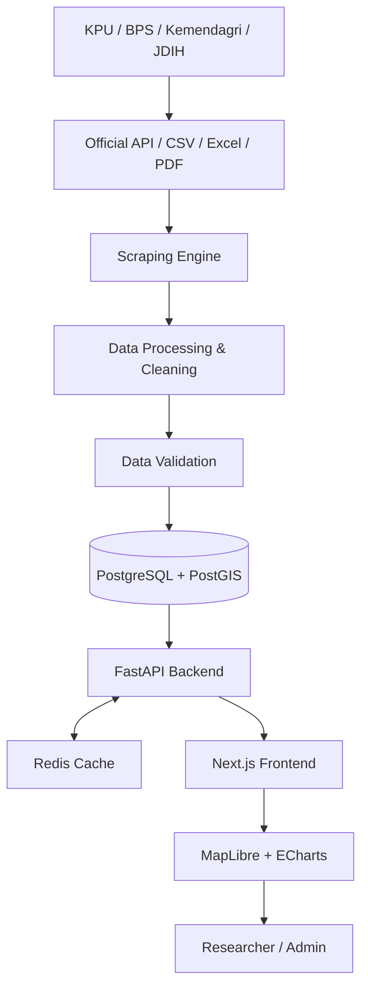
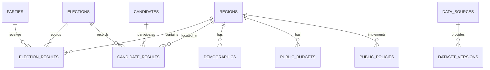
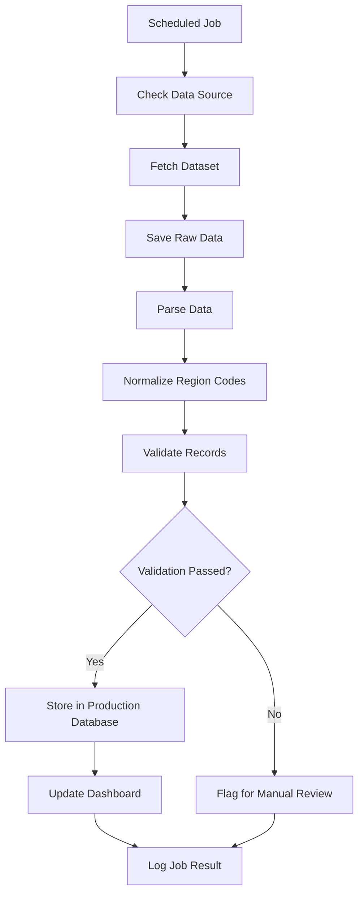
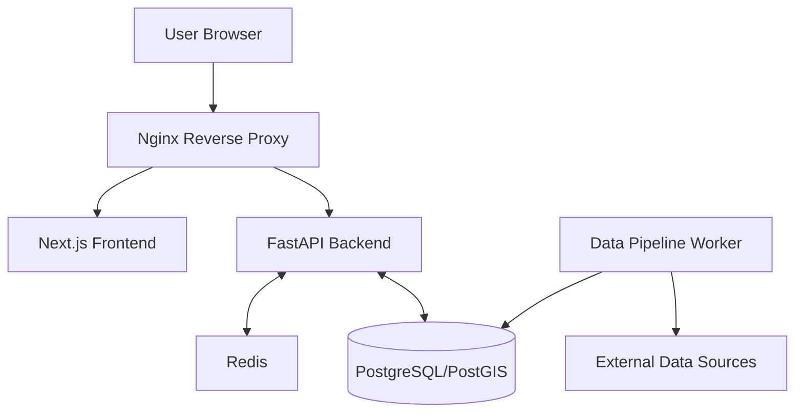

# SDD — Populi Political & Electoral Intelligence Dashboard (v1.0)

> **Status:** dokumen asli v1.0, disimpan sebagai acuan. Cakupan aktif yang dikerjakan ada di `REVISI-v1.1.md`; bila keduanya berbeda, v1.1 yang berlaku.

Berisi Bagian II–V dokumen asli: desain perangkat lunak, rencana implementasi, definisi analitik, dan prioritas MVP.

# BAGIAN II — SOFTWARE DESIGN DOCUMENT (SDD)

## 10. System Architecture

Sistem menggunakan arsitektur modular dengan pemisahan frontend, backend, database, dan data ingestion.

### 10.1 Technology Stack

| Layer | Teknologi | Fungsi |
| --- | --- | --- |
| Frontend | Next.js | Web application |
| Language | TypeScript | Frontend development |
| UI | Tailwind CSS + shadcn/ui | Komponen antarmuka |
| Mapping | MapLibre GL JS | Interactive mapping |
| Visualization | Apache ECharts | Grafik dan statistik |
| Geospatial | Deck.gl | Visualisasi spasial kompleks |
| Backend | Python FastAPI | REST API |
| Database | PostgreSQL | Database utama |
| GIS Extension | PostGIS | Data spasial |
| Data Processing | Pandas | Data cleaning |
| Scraping | Scrapy | Web scraping |
| Dynamic Scraping | Playwright | Website dinamis |
| PDF Extraction | Camelot / Tabula | Ekstraksi tabel PDF |
| Scheduling | Prefect | Orkestrasi pipeline |
| Cache | Redis | Cache dan performa |
| Deployment | Docker | Containerization |
| Web Server | Nginx | Reverse proxy |

### 10.2 System Architecture Diagram



### 10.3 Arsitektur Data Pipeline

Proses pengumpulan data:

1. Source Discovery: identifikasi sumber.
2. Data Acquisition: API, scraping atau upload.
3. Raw Storage: penyimpanan data mentah.
4. Parsing: ekstraksi informasi.
5. Cleaning: pembersihan data.
6. Normalization: penyesuaian format.
7. Validation: pemeriksaan kualitas.
8. Database Integration: penyimpanan data terstruktur.
9. API Publishing: data disediakan untuk frontend.
10. Visualization: data ditampilkan pada dashboard.

Setiap proses harus memiliki log, status, waktu eksekusi, dan informasi kesalahan.

## 11. Database Design

Database menggunakan PostgreSQL dan PostGIS.

### 11.1 Entity Relationship Overview

Entitas utama:



### 11.2 Tabel Database

#### A. regions

| Field | Type | Description |
| --- | --- | --- |
| id | UUID | Primary key |
| region_code | VARCHAR | Kode wilayah resmi |
| region_name | VARCHAR | Nama wilayah |
| region_level | VARCHAR | Province/Regency/District/Village |
| parent_id | UUID | Relasi wilayah induk |
| geometry | GEOMETRY | Batas wilayah |
| valid_from | DATE | Awal masa berlaku |
| valid_until | DATE | Akhir masa berlaku |

#### B. elections

| Field | Type |
| --- | --- |
| id | UUID |
| election_name | VARCHAR |
| election_type | VARCHAR |
| election_year | INTEGER |
| election_date | DATE |
| description | TEXT |

Contoh election_type:

- Presidential.
- Legislative_DPR.
- Legislative_DPRD_Province.
- Legislative_DPRD_Regency.
- Regional_Head.

#### C. parties

| Field | Type |
| --- | --- |
| id | UUID |
| party_code | VARCHAR |
| party_name | VARCHAR |
| party_logo | TEXT |
| status | VARCHAR |

#### D. candidates

| Field | Type |
| --- | --- |
| id | UUID |
| candidate_name | VARCHAR |
| photo_url | TEXT |
| birth_date | DATE |
| political_background | TEXT |
| biography | TEXT |

#### E. election_results

| Field | Type |
| --- | --- |
| id | UUID |
| election_id | UUID |
| region_id | UUID |
| party_id | UUID |
| vote_count | BIGINT |
| valid_votes | BIGINT |
| vote_share | DECIMAL |
| source_id | UUID |
| verification_status | VARCHAR |

#### F. candidate_results

| Field | Type |
| --- | --- |
| id | UUID |
| election_id | UUID |
| region_id | UUID |
| candidate_id | UUID |
| vote_count | BIGINT |
| vote_share | DECIMAL |
| result_status | VARCHAR |

#### G. demographics

| Field | Type |
| --- | --- |
| id | UUID |
| region_id | UUID |
| year | INTEGER |
| population | BIGINT |
| poverty_rate | DECIMAL |
| unemployment_rate | DECIMAL |
| education_data | JSONB |
| age_distribution | JSONB |
| source_id | UUID |

#### H. public_budgets

| Field | Type |
| --- | --- |
| id | UUID |
| region_id | UUID |
| fiscal_year | INTEGER |
| revenue_budget | DECIMAL |
| expenditure_budget | DECIMAL |
| actual_revenue | DECIMAL |
| actual_expenditure | DECIMAL |
| source_id | UUID |

#### I. public_policies

| Field | Type |
| --- | --- |
| id | UUID |
| region_id | UUID |
| policy_name | VARCHAR |
| policy_category | VARCHAR |
| policy_year | INTEGER |
| description | TEXT |
| document_url | TEXT |
| source_id | UUID |

#### J. data_sources

| Field | Type |
| --- | --- |
| id | UUID |
| source_name | VARCHAR |
| source_url | TEXT |
| source_type | VARCHAR |
| collection_method | VARCHAR |
| last_updated | TIMESTAMP |

#### K. dataset_versions

| Field | Type |
| --- | --- |
| id | UUID |
| source_id | UUID |
| dataset_name | VARCHAR |
| version_number | INTEGER |
| collected_at | TIMESTAMP |
| record_count | INTEGER |
| validation_status | VARCHAR |
| file_reference | TEXT |

Catatan desain: tambahkan tabel "users", "roles", "audit_logs", "ingestion_jobs", "raw_datasets", dan tabel penghubung kandidat-partai/koalisi. Gunakan UUID sebagai identitas internal dan kode wilayah resmi sebagai kunci referensi eksternal.

Untuk hasil pemilu, tambahkan dimensi dapil, jenis kontestasi, tingkatan wilayah, dan satuan penghitungan. Hal ini penting agar hasil DPR, DPRD, dan Pilkada tidak tercampur.

## 12. Data Scraping & Integration Specification

### 12.1 Data Source Mapping

| Sumber | Dataset | Metode |
| --- | --- | --- |
| KPU | Hasil Pemilu | API/CSV/HTML/PDF |
| KPU | Hasil Pilkada | API/CSV/HTML/PDF |
| BPS | Data demografi | API/CSV/XLSX |
| Kemendagri | Wilayah dan kepala daerah | Dataset resmi |
| JDIH | Dokumen kebijakan | API/HTML/PDF |
| Kementerian Keuangan | Data fiskal | Dataset resmi |
| OpenStreetMap | Data geospasial | Overpass/API atau unduhan data |

Pengambilan data harus mengikuti ketentuan masing-masing sumber.

### 12.2 Scraping Workflow



### 12.3 Contoh Script Python

Berikut contoh sederhana untuk memproses data hasil pemilu dalam format CSV.

```python
import pandas as pd

def process_election_data(file_path):
    df = pd.read_csv(file_path)

    required_columns = [
        "region_code",
        "party_name",
        "vote_count",
        "election_year"
    ]

    missing = [
        col for col in required_columns
        if col not in df.columns
    ]

    if missing:
        raise ValueError(
            f"Missing columns: {missing}"
        )

    df["vote_count"] = pd.to_numeric(
        df["vote_count"],
        errors="coerce"
    )

    df = df.dropna(
        subset=["region_code", "vote_count"]
    )

    df["vote_count"] = df["vote_count"].astype(int)

    result = df.groupby(
        ["region_code", "party_name", "election_year"],
        as_index=False
    )["vote_count"].sum()

    return result

data = process_election_data(
    "election_results.csv"
)

data.to_csv(
    "processed_election_results.csv",
    index=False
)
```

Script tersebut merupakan contoh awal. Implementasi produksi harus menambahkan validasi duplikasi, kode wilayah, jenis pemilihan, satuan suara, dan mekanisme rekonsiliasi terhadap data sumber.

### 12.4 Data Quality Control

Setiap dataset wajib memiliki:

- Source URL.
- Nama instansi.
- Tanggal pengambilan.
- Tahun data.
- Tingkat wilayah.
- Metode pengumpulan.
- Jumlah record.
- Status validasi.
- Versi dataset.

Validasi utama:

1. Tidak ada kode wilayah yang tidak dikenal.
2. Tidak ada data suara negatif.
3. Tidak ada duplikasi record.
4. Total suara sesuai dengan agregasi data sumber.
5. Data partai dan kandidat sesuai dengan kontestasi.
6. Tahun data tidak tertukar.
7. Data yang tidak lengkap diberi status khusus.
8. Perubahan dataset tercatat dalam audit log.

Data yang gagal validasi tidak boleh langsung menggantikan data produksi.

## 13. API Design

Backend menggunakan FastAPI dengan REST API.

Base URL:

`/api/v1`

### 13.1 Endpoint Utama

**Authentication**

| Method | Endpoint | Fungsi |
| --- | --- | --- |
| POST | /auth/login | Login |
| POST | /auth/logout | Logout |
| GET | /auth/me | Informasi pengguna |

**Regions**

| Method | Endpoint | Fungsi |
| --- | --- | --- |
| GET | /regions | Daftar wilayah |
| GET | /regions/{id} | Detail wilayah |
| GET | /regions/{id}/children | Wilayah turunan |
| GET | /regions/geojson | Geometri wilayah |

**Elections**

| Method | Endpoint | Fungsi |
| --- | --- | --- |
| GET | /elections | Daftar pemilu |
| GET | /elections/{id} | Detail pemilu |
| GET | /elections/{id}/results | Hasil pemilu |
| GET | /elections/compare | Perbandingan pemilu |

**Political Parties**

| Method | Endpoint | Fungsi |
| --- | --- | --- |
| GET | /parties | Daftar partai |
| GET | /parties/{id} | Profil partai |
| GET | /parties/{id}/results | Hasil elektoral partai |

**Candidates**

| Method | Endpoint | Fungsi |
| --- | --- | --- |
| GET | /candidates | Daftar kandidat |
| GET | /candidates/{id} | Profil kandidat |
| GET | /candidates/{id}/results | Hasil kandidat |

**Demographics**

| Method | Endpoint | Fungsi |
| --- | --- | --- |
| GET | /demographics | Data demografi |
| GET | /demographics/{region_id} | Demografi wilayah |

**Data Management**

| Method | Endpoint | Fungsi |
| --- | --- | --- |
| GET | /admin/sources | Daftar sumber |
| POST | /admin/import | Import dataset |
| POST | /admin/scraping/run | Menjalankan job |
| GET | /admin/jobs | Status scraping |
| GET | /admin/validation | Hasil validasi |

### 13.2 Contoh API Response

Endpoint:

`GET /api/v1/elections/{id}/results?region_code=3204`

Contoh respons:

```json
{
  "election_year": 2024,
  "region": {
    "code": "3204",
    "name": "Kabupaten Bandung"
  },
  "results": [
    {
      "party_name": "Partai A",
      "vote_count": 125000,
      "vote_share": 32.5
    },
    {
      "party_name": "Partai B",
      "vote_count": 95000,
      "vote_share": 24.7
    }
  ],
  "source": "KPU",
  "verification_status": "verified"
}
```

Angka di atas hanya contoh ilustrasi struktur respons, bukan hasil pemilu sebenarnya.

## 14. Frontend Design Specification

### 14.1 Main Layout

**Sidebar Navigation**

- Overview
- Electoral Map
- Political Parties
- Candidates
- Regional Leaders
- Demographics
- Public Policy
- Data Management
- Reports
- Settings

**Top Navigation**

- Global search.
- Tahun pemilu.
- Filter wilayah.
- Notifikasi.
- User profile.

### 14.2 Overview Page

Komponen:

1. KPI Cards.
2. Indonesia/Jawa Barat Political Map.
3. Party Vote Ranking.
4. Electoral Trend.
5. Latest Data Updates.
6. Regional Comparison.

### 14.3 Electoral Map Page

Layout:

- Peta sebagai komponen utama.
- Panel filter di sisi kiri.
- Panel detail wilayah di sisi kanan.
- Legend di bagian bawah peta.
- Pilihan layer di atas peta.

Contoh interaksi:

Pengguna memilih:

- Pemilu: 2024.
- Jenis: DPRD Kabupaten/Kota.
- Wilayah: Jawa Barat.
- Layer: Party Dominance.

Sistem menampilkan peta berdasarkan partai dengan suara terbanyak di setiap wilayah yang memiliki data valid.

Ketika pengguna mengklik Kabupaten Bandung, sistem menampilkan distribusi suara masing-masing partai, persentase suara, dan tren perbandingan periode sebelumnya jika tersedia.

### 14.4 Design System

Rekomendasi visual:

- Primary: Dark Navy.
- Secondary: White.
- Background: Light Gray.
- Accent: Orange.
- Success: Green.
- Warning: Amber.

Gaya desain:

- Minimalist.
- Data-centric.
- Professional research interface.
- High readability.
- Responsive.

Warna partai harus menggunakan identitas visual yang sesuai dan dapat dikonfigurasi, bukan warna yang ditetapkan berdasarkan asumsi.

## 15. Security & Access Control

Menggunakan Role-Based Access Control (RBAC).

| Fitur | Admin | Researcher | Viewer |
| --- | --- | --- | --- |
| Melihat dashboard | Ya | Ya | Ya |
| Melihat peta | Ya | Ya | Ya |
| Mengunduh data | Ya | Ya | Sesuai izin |
| Import dataset | Ya | Tidak | Tidak |
| Menjalankan scraping | Ya | Tidak | Tidak |
| Validasi data | Ya | Tidak | Tidak |
| Mengelola pengguna | Ya | Tidak | Tidak |
| Mengubah konfigurasi | Ya | Tidak | Tidak |

Persyaratan keamanan:

- Password hashing.
- Secure session.
- HTTPS.
- API authentication.
- Rate limiting.
- Input validation.
- Audit logging.
- Database backup.
- Pembatasan akses data internal.

Jika nantinya menggunakan data survei responden Populi Center, identitas dan preferensi politik individu harus dipisahkan dari data analisis publik. Penggunaan data harus mengikuti persetujuan, tujuan pengumpulan, kebijakan retensi, dan ketentuan perlindungan data pribadi.

## 16. Deployment Architecture

Rekomendasi lingkungan:

**Development**

- Local Docker.
- Database lokal.
- Data sampel.

**Staging**

- Server testing.
- Database staging.
- UAT internal.

**Production**

- VPS atau cloud server.
- PostgreSQL + PostGIS.
- Redis.
- Backend FastAPI.
- Frontend Next.js.
- Nginx.
- Automated backup.

Contoh deployment:



---

# BAGIAN III — IMPLEMENTATION PLAN

## 17. Development Roadmap

Estimasi pelaksanaan: 12–16 minggu.

| Minggu | Kegiatan | Output |
| --- | --- | --- |
| 1–2 | Requirement & data discovery | Final PRD dan dataset inventory |
| 3–4 | Database & backend foundation | Database dan API dasar |
| 5–6 | Data ingestion | Pipeline dan data elektoral |
| 7–8 | Geospatial integration | Peta interaktif |
| 9–10 | Electoral analytics | Perbandingan dan analisis suara |
| 11–12 | Party intelligence | Modul partai |
| 13–14 | Data management & reporting | Admin dan export |
| 15 | Testing & validation | QA report |
| 16 | UAT & deployment | Pilot release |

## 18. Development Team

Tim minimum yang direkomendasikan:

| Posisi | Tanggung Jawab |
| --- | --- |
| Product Owner | Arah produk dan prioritas |
| Product/UI Designer | Desain antarmuka |
| Frontend Developer | Next.js dan visualisasi |
| Backend Developer | API dan database |
| Data Engineer | Scraping dan pipeline |
| GIS Specialist | Geospasial dan peta |
| Research Analyst | Validasi dan metodologi |
| QA Tester | Pengujian sistem |

Beberapa posisi dapat dirangkap dalam tim kecil.

## 19. Testing Strategy

**Unit Testing**

Menguji:

- Kalkulasi vote share.
- Electoral swing.
- Validasi data.
- Normalisasi wilayah.
- API response.

**Integration Testing**

Menguji:

- Scraping ke database.
- Database ke backend.
- Backend ke frontend.
- Peta ke geometri wilayah.

**Performance Testing**

Menguji:

- Pemuatan peta.
- Filter data.
- Agregasi hasil.
- Ekspor dataset.

**User Acceptance Testing**

Melibatkan peneliti Populi Center dengan skenario:

1. Melihat hasil Pemilu 2024.
2. Membandingkan hasil 2019 dan 2024.
3. Menemukan partai dominan di suatu kabupaten.
4. Melihat detail kecamatan.
5. Mengunduh data.
6. Memeriksa sumber dataset.

## 20. Risks & Mitigation

| Risiko | Mitigasi |
| --- | --- |
| Sumber data berubah | Gunakan adapter per sumber |
| Scraping gagal | Retry, monitoring, dan manual import |
| Data tidak konsisten | Standardisasi dan validasi |
| Batas wilayah berubah | Simpan versi geometri dan periode berlaku |
| Data tidak tersedia | Tandai missing data |
| Performa peta lambat | Spatial indexing dan caching |
| Kesalahan interpretasi | Dokumentasi metodologi |
| Data sensitif bocor | RBAC, minimisasi dan enkripsi data |
| Perubahan format sumber | Simpan raw data dan versioning |

---

# BAGIAN IV — DEFINISI ANALYTICS

## 21. Formula Analisis Elektoral

### 21.1 Vote Share

Vote Share = (Suara Partai / Total Suara Sah) × 100%

### 21.2 Electoral Swing

Electoral Swing = Vote Share Periode Baru − Vote Share Periode Sebelumnya.

Contoh:

- Partai A tahun 2019: 25%.
- Partai A tahun 2024: 32%.
- Swing: +7 percentage points.

### 21.3 Margin of Victory

Margin of Victory = Suara Pemenang − Suara Peringkat Kedua.

### 21.4 Turnout

Turnout = (Jumlah Pemilih yang Menggunakan Hak Pilih / Jumlah Pemilih Terdaftar) × 100%.

### 21.5 Party Dominance

Partai dominan ditentukan berdasarkan jumlah suara tertinggi atau vote share tertinggi pada kontestasi dan wilayah yang sama.

Catatan metodologi:

- Jangan mencampur suara DPR RI dan DPRD.
- Jangan membandingkan angka absolut dari wilayah yang mengalami perubahan batas tanpa harmonisasi.
- Perubahan suara harus membedakan perubahan persentase dan perubahan jumlah suara.
- Data suara partai dan suara kandidat tidak selalu memiliki basis penghitungan yang sama.

## 22. Data Governance

Semua data harus memiliki klasifikasi:

| Klasifikasi | Contoh |
| --- | --- |
| Public | Hasil pemilu resmi |
| Internal | Dataset penelitian internal |
| Restricted | Data survei yang memiliki pembatasan akses |
| Confidential | Data yang mengandung identitas responden |

Prinsip utama:

1. Setiap data memiliki sumber.
2. Setiap data memiliki periode.
3. Setiap data memiliki status verifikasi.
4. Setiap perubahan tercatat.
5. Data yang tidak lengkap tidak disajikan sebagai data lengkap.
6. Hasil analisis dapat ditelusuri kembali ke dataset sumber.

## 23. Deliverables

Pada akhir pilot project, tim pengembang harus menyerahkan:

**Product**

- PRD final.
- User flow.
- UI/UX design.
- Dashboard web.

**Software**

- Frontend source code.
- Backend source code.
- Database schema.
- API documentation.
- Deployment documentation.
- Docker configuration.

**Data Engineering**

- Scraping scripts.
- Data processing scripts.
- Data pipeline.
- Data validation scripts.
- Data dictionary.
- Source inventory.

**Research & Analytics**

- Definisi indikator.
- Metodologi perhitungan.
- Dataset elektoral.
- Dataset demografi.
- Laporan validasi data.

**Operational**

- Administrator guide.
- User guide.
- Backup procedure.
- Maintenance procedure.

---

# BAGIAN V — PRIORITAS PENGEMBANGAN MVP

## 24. Final MVP Definition

Untuk menghindari pengembangan yang terlalu luas, MVP dibatasi pada tiga modul utama.

**MVP 1 — Electoral Mapping**

- Peta Jawa Barat.
- Hasil Pemilu 2019 dan 2024.
- Pemetaan suara partai.
- Peta dominasi partai.
- Filter kabupaten/kota.
- Detail suara setiap wilayah.

**MVP 2 — Political Party Intelligence**

- Profil partai.
- Perbandingan suara.
- Ranking partai.
- Electoral swing.
- Distribusi kekuatan partai.

**MVP 3 — Data Management**

- Upload CSV/XLSX.
- Import dataset.
- Validasi data.
- Metadata sumber.
- Riwayat pembaruan.
- Export data.

Modul Pilkada, kepala daerah, demografi, dan kebijakan publik menjadi tahap pengembangan berikutnya setelah fondasi MVP tervalidasi.

## 25. Definition of Done

Pilot project dapat dinyatakan selesai apabila:

- [ ] Sistem dapat diakses melalui browser.
- [ ] Login dan hak akses berfungsi.
- [ ] Database PostgreSQL/PostGIS berjalan.
- [ ] Data wilayah Jawa Barat tersedia.
- [ ] Data elektoral 2019 dan 2024 terintegrasi.
- [ ] Peta interaktif berfungsi.
- [ ] Perbandingan suara berfungsi.
- [ ] Modul partai berfungsi.
- [ ] Import dan validasi data berfungsi.
- [ ] Metadata sumber dapat dilihat.
- [ ] Export data berfungsi.
- [ ] Pengujian UAT selesai.
- [ ] Dokumentasi teknis diserahkan.
- [ ] Backup dan prosedur pemulihan diuji.

---

# PENUTUP

Populi Political & Electoral Intelligence Dashboard dirancang sebagai infrastruktur data politik dan penelitian yang dapat dikembangkan secara bertahap.

Pilot project Jawa Barat menjadi fondasi untuk membangun sistem yang lebih luas, mencakup seluruh wilayah Indonesia.

Keunggulan utama platform ini bukan hanya pada kemampuan menampilkan peta, tetapi pada integrasi data elektoral, demografi, tokoh politik, dan kebijakan publik dalam satu lingkungan analisis.

Dalam jangka panjang, platform ini dapat menjadi salah satu infrastruktur riset digital Populi Center untuk mendukung penelitian opini publik, analisis politik, pemetaan elektoral, dan evaluasi kebijakan publik.

Dokumen: PRD & SDD v1.0
Product Owner: Populi Center
Status: Draft untuk review dan persetujuan pilot project.
